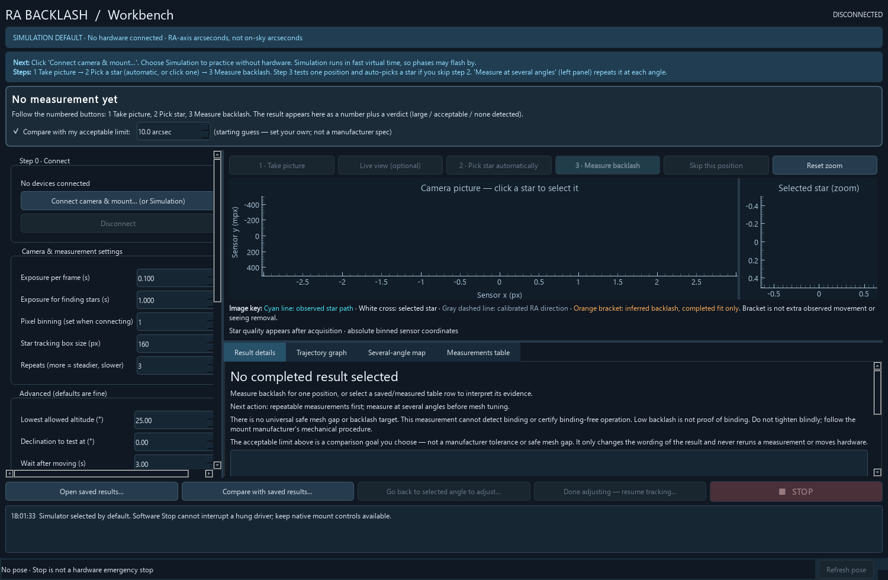
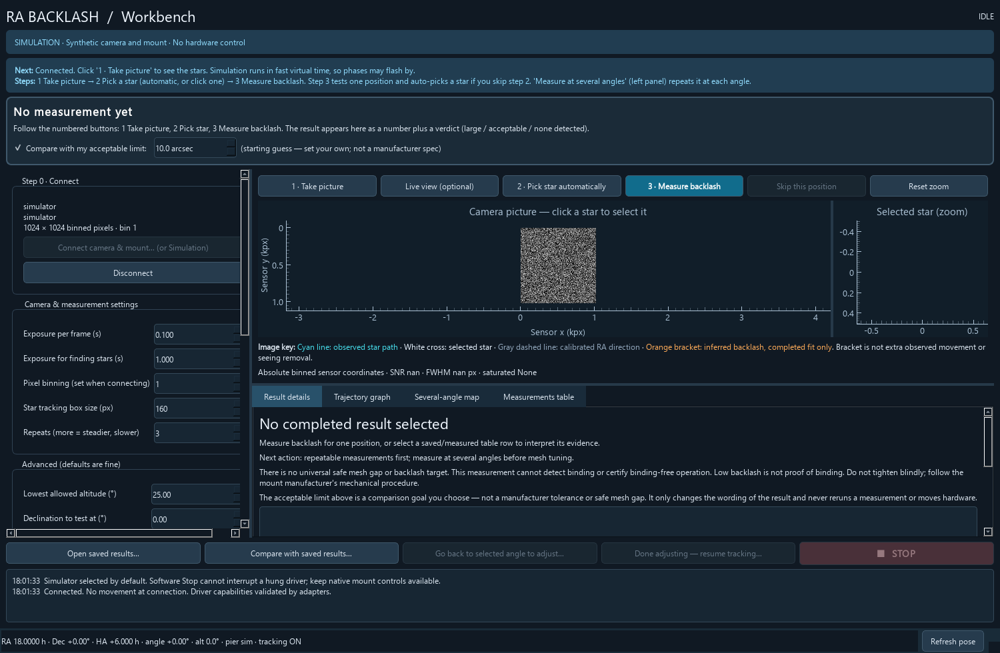
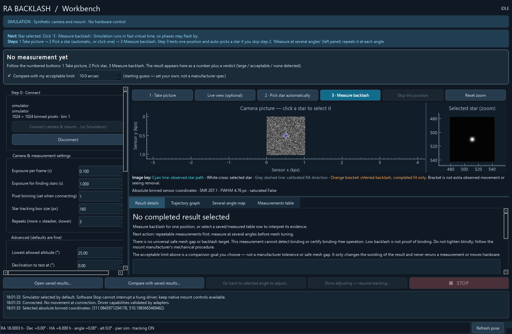
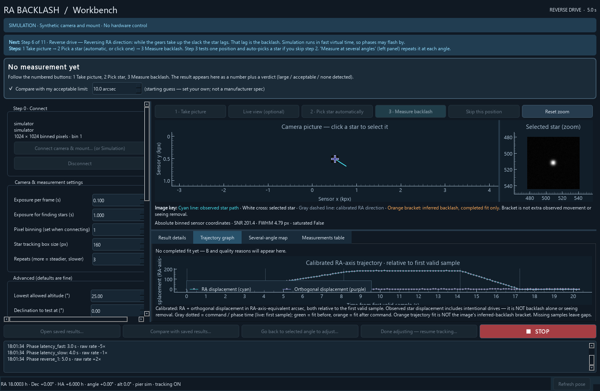
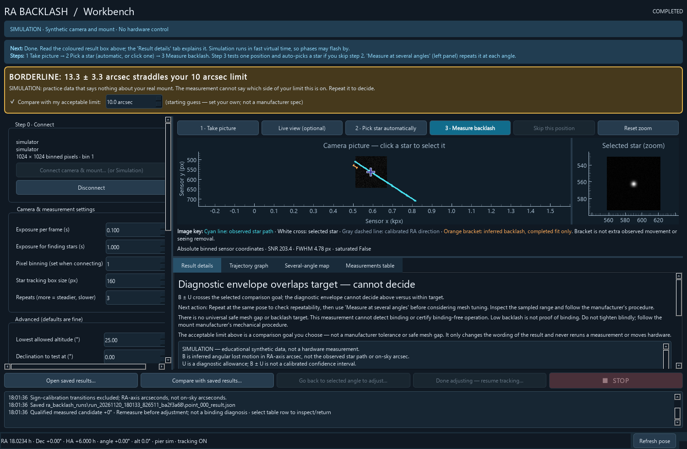
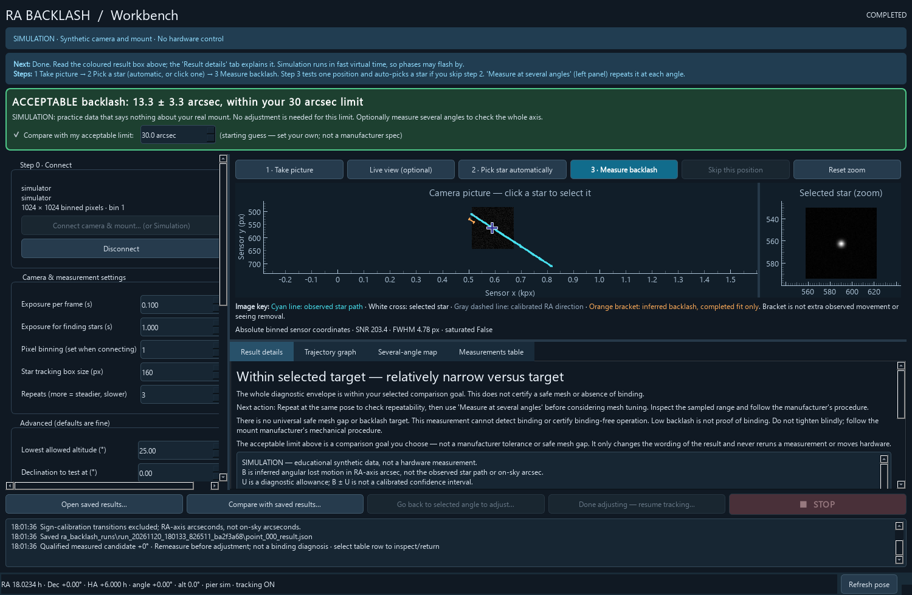
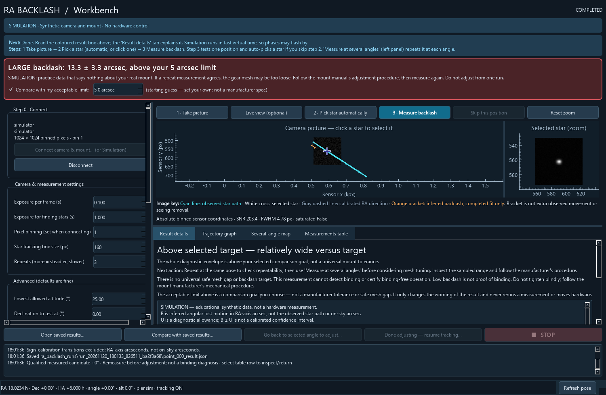
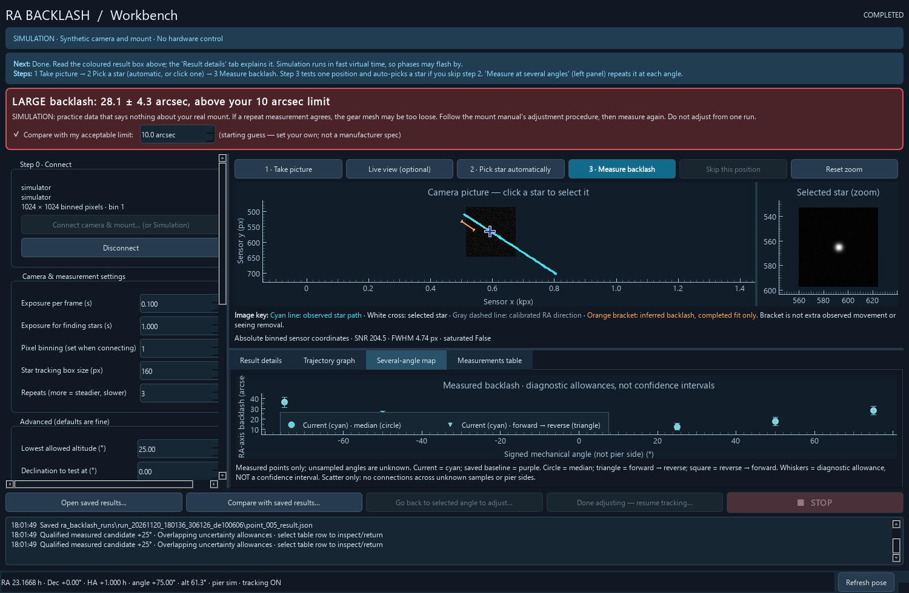

# Quick start guide

This guide covers measuring RA backlash with the desktop app. All screenshots are from the **Simulation**, which uses fake data and says nothing about a real mount.

Start the app with `python -m ra_backlash_app`.

## What the app does

Backlash is the slack in the RA gears. When the motor reverses direction, the mount first takes up the slack before the star moves. The app measures that slack by watching a star while it drives RA back and forth. It reports the slack in **arcseconds**.

## The short version

1. Connect.
2. Click **1 · Take picture**.
3. Click **2 · Pick star automatically**.
4. Click **3 · Measure backlash** and wait.
5. Read the coloured box at the top.

## Step by step

### 0. Connect

Click **Connect camera & mount…**. Keep **Simulation** ticked to practice. Untick it to use your real mount and camera through ASCOM. Connecting does not move anything and takes no pictures.

### 1. Take picture

Click **1 · Take picture**. You see the camera view with stars. The mount does not move.

### 2. Pick a star

Click **2 · Pick star automatically**. You can also click a bright, isolated star in the picture. A white cross marks the chosen star. Pick a star that is not too bright and not close to other stars.

### 3. Measure backlash

Click **3 · Measure backlash** and confirm the question that appears. The app then:

1. turns tracking off for a few seconds to learn how the star moves,
2. drives RA back and forth,
3. calculates the result.

The panel at the top shows "Step n of N". A real mount takes about a minute and a half. The simulator takes seconds. Press **STOP** at any time.

### 4. Read the result

The coloured box at the top gives the number and a verdict:

| Box | What it means | What to do |
| --- | --- | --- |
| **ACCEPTABLE** (green) | Backlash is within your limit. | Nothing needed. |
| **LARGE** (red) | Backlash is above your limit. | Repeat the measurement. If it agrees, adjust the gear mesh following your mount's manual, then measure again. |
| **BORDERLINE** (amber) | The value is too close to your limit to call. | Repeat the measurement. |
| **NO BACKLASH DETECTED** (amber) | Too small to measure. This may be very small backlash **or** gears that are too tight (binding). The test cannot tell which. | Repeat once. If the mount feels rough or stalls, inspect it. |
| **INCONCLUSIVE / UNRELIABLE** | The run was not good enough to trust. | Repeat with a better star or steadier sky. |

The number looks like **13.3 ± 3.3 arcsec**: about 13 arcsec of slack, give or take 3.

### Set your own limit

Next to **Compare with my acceptable limit** you can type your own number. It starts at **10 arcsec**, which is only a guess and not a manufacturer value. A common rule: backlash matters when it is larger than your guiding error or seeing. This setting only changes the wording of the verdict. It never moves the mount.

The same measurement of 13.3 arcsec reads ACCEPTABLE against a 30 arcsec limit and LARGE against a 5 arcsec limit.

The **Result details** tab explains the result in more depth.

## Optional: measure at several angles

Backlash can vary around the RA gear. To check, use the section **Optional · measure at several angles** in the left panel.

1. Leave the defaults. They give six angles: −75, −50, −25, +25, +50 and +75°.
2. Click **Check which angles are reachable**. Nothing moves.
3. Click **Measure at several angles…** and confirm. For each angle the mount moves there, picks its own star and measures. The panel shows "Angle k of M".
4. Open the **Several-angle map** tab. Each dot is one angle, and lower is tighter. Higher dots are looser.

The star you clicked is not used here. Each angle picks its own star. Angles are signed mount positions, not the physical pier side.

## Leave these alone

The **Advanced** group in the left panel and the camera settings can stay at their defaults. Change them only if results keep coming back noisy.

## Safety

- The app is experimental and has not been tested on a real mount.
- **STOP** is a software request, not an emergency stop. Keep the mount's own controls within reach.
- Stop guiding before measuring, and make sure nothing can collide or snag.
- Do not adjust the gears from a single result. Repeat the measurement first.
- A low backlash number is not proof of a healthy mount.
